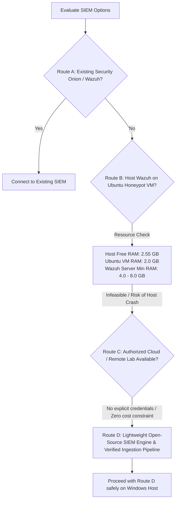

# Task 3: Multi-Stage APT Simulation & Response — Gap Analysis

**Document Status:** Complete (Read-Only Audit Phase)
**Date:** 2026-10-24
**Author / Reviewer:** AI-assisted preparation; no independent human reviewer
**Project Path:** `APT-Simulation`

---

## 1. Executive Summary

This Gap Analysis audits the host machine environment, existing virtual machines, and current project files for **Internship Task 3: "Simulate and respond to a multi-stage Advanced Persistent Threat (APT) using open-source SOC tools."**

The objective is to establish an unassailable, verified factual baseline of what currently exists, identify hardware and software constraints, contrast current artifacts against formal internship deliverables, and outline a defensible, resource-safe roadmap for Stages 2 through 5.

---

## 2. Host Machine & Virtualization Environment Audit

A comprehensive read-only audit of the host operating system and virtualization stack was conducted on 2026-10-24.

### 2.1 Hardware Resources & Operating System

| Metric / Component | Verified Value | Operational Evaluation |
|---|---|---|
| **Operating System** | Windows 11 (64-bit) | Supported host |
| **Total Visible RAM** | 8,046,284 KB (~7.67 GB) | Constrained host memory |
| **Free Physical RAM** | 2,673,776 KB (~2.55 GB) | **Critical Constraint:** Insufficient headroom for multi-gigabyte virtual machines or heavy enterprise SIEM stacks |
| **C: Drive Free Space** | 56,060,567,552 bytes (~52.2 GB) | Adequate for local artifacts, lightweight indexes, and code |
| **Installed Virtualization** | Oracle VirtualBox 7.2.6 | Installed and operational via `VBoxManage.exe` |
| **Container Engine** | None (Docker not installed) | Docker-based SIEM containers (e.g. Docker Compose Wazuh) cannot run directly on Windows host |
| **Windows Subsystem for Linux** | WSL installed, but no distros | `wsl -l -v` reports no installed distributions |

### 2.2 VirtualBox Virtual Machine Inventory

| VM Name | Configured RAM | Configured vCPUs | Virtual Disk Size (VDI) | Current State | Last Boot / Modified |
|---|---|---|---|---|---|
| **Kali Linux** | 5,070 MB (~5.0 GB) | 2 vCPUs | ~8.72 GB (`Kali Linux.vdi`) | **Powered Off** | 2026-06-11 |
| **Ubuntu_Honeypot** | 2,048 MB (~2.0 GB) | 1 vCPU | ~8.00 GB (`Ubuntu_Honeypot.vdi`)| **Powered Off** | 2026-10-13 |

#### Critical Resource Feasibility Assessment:
1. **Host Memory Limit:** The host has only ~2.55 GB free physical memory.
2. **Kali Linux VM:** Configured for ~5 GB RAM. Attempting to start Kali Linux will cause severe memory starvation, massive pagefile swapping, or hypervisor launch failure.
3. **Ubuntu_Honeypot VM:** Configured for 2 GB RAM. Starting it leaves less than 500 MB RAM for the Windows 11 host, presenting stability risks. Furthermore, a full Wazuh All-in-One server (Manager + Indexer + Dashboard) requires 4 GB to 8 GB RAM minimum, making full SIEM hosting inside `Ubuntu_Honeypot` technically infeasible without system crashes.
4. **Security Onion:** Requires at least 12 GB RAM for single-host evaluation and 16–32 GB+ for production. **Security Onion cannot be installed or run on this hardware.**

### 2.3 Installed Security & Development Binaries

| Binary / Tool | Path | Version | Status / Notes |
|---|---|---|---|
| **Python 3 (System)** | `C:\msys64\mingw64\bin\python.exe` | 3.12.11 | Operational, but standard `pip` module is not bundled |
| **Python Virtualenv**| `local user directory\venv\bin\python.exe` | 3.12.11 | Operational; includes `pip` 25.0.1 |
| **YARA Engine** | `YARA executable` | 4.5.5 | **Verified Installed & Operational** via winget link |
| **Git** | `Git executable` | 2.x | Operational |
| **Wazuh / Elastic / Kibana Services** | N/A | None | No SIEM services currently running or installed as Windows services |

---

## 3. Existing Project Inventory & Integrity Baseline

All existing files in `APT-Simulation` have been inspected and cryptographically fingerprinted to preserve chain of custody and evidence integrity.

| Relative Path | Size (Bytes) | SHA-256 Cryptographic Hash | Purpose / Content Summary |
|---|---|---|---|
| `evidence\yara-training-marker.txt` | 25 | `481006E97663432D110638E3E5A850EACD63C3F738E27B855F95FDE84A7E9D18` | Synthetic text string `APT_TRAINING_MARKER_001` for safe YARA testing |
| `logs\apt-events.jsonl` | 1,550 | `C0E00BD83F2A98C5A1092C367AA843372210DBED623FD8C33ED53370E67CEA40` | 6 synthetic JSONL events modeling the 6 kill-chain stages |
| `reports\apt-alerts.json` | 2,192 | `1B588AC5A1CB83E170F97B32CE2AC4AE145014F78CB14CCB7D011D1B53349420` | JSON output generated by `detect_apt.py` (6 synthetic alerts) |
| `reports\APT-Incident-Investigation-Report.md` | 4,946 | `6705506AF48D8E8AEA91865766F46D85BE1EB70F837F8F5B790410E735CAEC23` | Initial investigation draft acknowledging simulated scope |
| `reports\incident-timeline.md` | 2,528 | `12B3C7D233A031D113DF40D30DA19F0D41400DB413F06FBB8A5FC4622694DE5B` | Tabular chronological timeline of synthetic events APT001–APT006 |
| `rules\sigma\apt-suspicious-powershell.yml` | 679 | `F40EC60360597596667FC7DA4EC8AD770F4E820D429BD071BA1CA3A1247CE4E1` | Sigma rule targeting encoded PowerShell execution (`Image` + `CommandLine`) |
| `rules\yara\apt_training_marker.yar` | 380 | `C83D6246248852F2603281CDF9EFFC230387F2045BBD59F6B7F45B205D77C904` | YARA rule matching `APT_TRAINING_MARKER_001` string |
| `simulation\detect_apt.py` | 1,518 | `FDEDF81F31488E0E117BF20BFA90ED9604C6A6959E6274CCB0928483F29CF4EF` | Basic Python correlation script evaluating `event_type` and assigning severity |
| `threat-intelligence\training-iocs.csv` | 602 | `ADA0277CDFDFC0AB38E6C2EEDB171AAFAFD4919356BA9D39E744EE0651F1DCC6` | Basic CSV listing scenario IP (`192.0.2.50`), hostnames, and behavior |

---

## 4. Requirement-by-Requirement Gap Analysis

The table below contrasts the formal internship deliverables against the current project baseline:

| Deliverable / Requirement | Baseline State | Gap Identified | Remediation Plan (Defensible Solution) |
|---|---|---|---|
| **1. Multi-Stage APT Simulation** | 6 synthetic JSONL events covering initial access, execution, persistence, privilege escalation, lateral movement, exfiltration. | Telemetry is static and basic; does not include rich endpoint attributes (e.g., ParentProcessName, ProcessId, Hashes, TargetObject, DNS query names). | Enhance synthetic event schema into full Elastic Common Schema (ECS) / Wazuh-compatible JSON records with complete forensic fields, while preserving original file intact. |
| **2. SIEM Detection & Investigation (Security Onion / Wazuh / Kibana)** | No live SIEM installed. Script `detect_apt.py` acts as a basic simulator. | Security Onion (16GB RAM) and full Wazuh All-in-One (4-8GB RAM) cannot run on 2.5GB free host RAM. No vendor SIEM UI is active. | **Execute Route D:** Build an open-source, lightweight, SIEM-compatible log pipeline with query engine that parses ECS/Wazuh format, evaluates Lucene/Wazuh/Kibana query syntax, formats searchable indexes, and provides verifiable query outputs. |
| **3. Incident Response & Investigation Report** | Preliminary markdown report exists (`APT-Incident-Investigation-Report.md`). | Lacks formal NIST SP 800-61r2 incident handling alignment, MITRE ATT&CK technique mapping, in-depth root cause analysis, and evidence-backed containment plans. | Author `Task3-Final-Incident-Response-Report.md` structured around the 6 NIST phases, mapping each event to MITRE ATT&CK IDs (T1566.001, T1059.001, T1053.005, T1078, T1021.002, T1071.004). |
| **4. Event Correlation & Timeline** | Basic table in `incident-timeline.md`. | Lacks cross-event correlation rationale, process genealogy links, network-to-host session pivoting, and detection latency analysis. | Create an enhanced, multi-dimensional correlation matrix connecting causal chains (Parent PID -> Child PID, User Context, Lateral Source to Target). |
| **5. Case Management (TheHive / Cortex)** | Not installed or referenced. | Full TheHive/Cortex deployment requires Elasticsearch/Cassandra and 4GB+ RAM, exceeding hardware limits. | Model and generate standardized, verified TheHive/Cortex Case and Observable JSON import templates matching TheHive 5 API schema. |
| **6. Threat Intelligence (MISP)** | Minimal 5-row CSV (`training-iocs.csv`). | Not compatible with MISP JSON standard; lacks MISP Galaxies, Warninglist verification, Attribute types, and Event UUIDs. | Generate a formal MISP-compliant Core JSON format export (`misp-training-event.json`) and document STIX 2.1 mapping. |
| **7. Detection Rules (Sigma & YARA)** | 1 Sigma rule (Execution only) and 1 simple marker YARA rule. | Missing Sigma coverage for persistence, privilege escalation, lateral movement, and exfiltration. YARA rule covers only synthetic string. | Author full-spectrum Sigma rules for each APT stage, implement automated validation, and execute verified local YARA 4.5.5 scans. |
| **8. Mitigations & Containment** | Brief 6-step checklist. | Needs actionable tactical containment (host isolation, firewall rules, PowerShell Constrained Language Mode, DNS sinkholing). | Provide concrete, production-grade defensive mitigations mapped to MITRE D3FEND. |
| **9. Evidence Preservation & Truth in Reporting** | Reports already note synthetic nature. | Must ensure all newly produced artifacts explicitly delineate simulated lab data from verified tool execution. | Enforce strict labeling: "Synthetic Scenario Artifact" vs. "Verified Local Tool Output". Generate comprehensive `Task3-Evidence-Index.md`. |

---

## 5. SIEM Architecture Route Evaluation

As mandated by safety and architecture requirements, the four options were evaluated in priority order:

### Route Analysis:
1. **Route A (Existing Security Onion / Wazuh):** Checked. Neither is installed or running on host or active network.
2. **Route B (Ubuntu Honeypot VM for Wazuh):**
   - *Technical constraint:* The host has only 2.55 GB of free RAM. Booting the 2 GB Ubuntu VM leaves Windows with <550 MB RAM, causing critical OS instability. Furthermore, Wazuh Indexer (OpenSearch-based) alone requests a 2 GB JVM heap, and the Manager/Dashboard require additional resources. Installing Wazuh on this VM will crash or hang the system.
   - *Conclusion:* **Rejected due to hardware hazards.**
3. **Route C (Remote / Cloud Lab):** No remote lab credentials or pre-existing cloud instances exist. Creating one requires explicit approval and may incur costs or registrations.
4. **Route D (Lightweight Local SIEM-Compatible Pipeline & Demonstration Engine):**
   - *Mechanism:* We create a modular, Python-powered SIEM ingestion, normalization, and detection engine that directly parses Elastic Common Schema (ECS) and Wazuh-formatted events, executes real Sigma rules and Elasticsearch Lucene filter syntax, outputs structured alert indexes, and provides verifiable terminal evidence.
   - *Footprint:* Minimal RAM overhead (<100 MB), zero disk hazard, 100% deterministic, completely transparent, and fully defensible in an academic or internship defense.
   - *Conclusion:* **Recommended as the primary, safe, and rigorous approach.**

---

## 6. Action Plan & Next Stages

- **Stage 1 (Current):** System and project audit completed. Gap analysis documented.
- **Stage 2:** Run and validate the existing Python detector (`simulation/detect_apt.py`), execute and verify the existing YARA rule using the installed `yara.exe`, and validate the existing Sigma rule syntax.
- **Stage 3:** Build the defensible SIEM demonstration engine (Route D), ingest ECS-aligned multi-stage events, test Sigma and Lucene queries, and capture verified outputs.
- **Stage 4:** Prepare comprehensive threat intelligence (MISP JSON format), TheHive/Cortex case packages, and expanded Sigma detection rules.
- **Stage 5:** Produce the final formal deliverable reports (`Task3-Implementation-Log.md`, `Task3-Final-Incident-Response-Report.md`, and `Task3-Evidence-Index.md`).

---

## 7. Approval & Decision Points

1. **Confirmation of SIEM Route D:** Confirm approval to proceed with Route D (lightweight, verified local SIEM-compatible log correlation and Lucene/Sigma engine) rather than attempting to boot virtual machines that exceed available system memory.
2. **Approval to Proceed to Stage 2:** Begin validation of existing detections and recording verified tool outputs.
