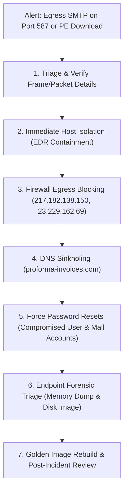

# HawkEye — Blue Team Report
## Defensive Network Monitoring, Detection Engineering & SOC Incident Triage

**Document Reference:** ELEV-SOC-HAWKEYE-BLUE-2026-001
**Internship Module:** Task 1 — HawkEye Tri-Team Analysis (Blue Team Perspective)
**Student Intern:** Aiswarya
**Degree / Branch:** Bachelor of Technology (B.Tech) in Artificial Intelligence & Data Science
**Academic Institution:** Jyothi Engineering College (Autonomous), Thrissur, Kerala
**Affiliated University:** APJ Abdul Kalam Technological University
**Internship Provider:** ElevanceSkills
**Date of Analysis:** 2026-10-02 (Revised & Verified: 2026-10-31)
**Classification:** TLP:CLEAR / Educational Threat Analysis Portfolio
**Status:** **Completed & Verified (Educational Threat Analysis Portfolio — Grounded in Empirical PCAP Telemetry)**

---

> [!IMPORTANT]
> **EVIDENTIARY BOUNDARY & DEFENSIVE DISCLOSURE:**
> This report documents the defensive analysis of `stealer.pcap` (4,003 total packets) from the perspective of a SOC Tier 1/2 Analyst.
> - **Empirical Wire Telemetry:** Network-layer observations (DNS queries, HTTP payload carving, IP reflections, and authenticated SMTP sessions) represent confirmed ground truth from the packet capture.
> - **Base64 Encoding vs. Encryption:** SMTP authentication tokens and exfiltration message bodies utilize Base64 encoding (RFC 4648). Base64 is a reversible encoding scheme, **not cryptographic encryption**; credentials and message contents are transmitted in cleartext on the wire.
> - **Periodic Traffic vs. Host Scheduling:** While network telemetry reveals 7 periodic exfiltration cycles at ~10-minute intervals, the network data alone cannot establish the underlying host implementation mechanism (such as an application `Sleep()` loop, an event timer, or a Windows Scheduled Task).
> - **Inferred Endpoint Events:** Internal host activity (such as process execution, keystroke hook injection, and registry persistence) is inferred from the decrypted exfiltration payload and requires host-level sensor telemetry (Sysmon / EDR) to confirm on the endpoint itself.
> - **Proposed Rules Status:** Network detection signatures (Suricata/Snort) represent **proposed detection engineering drafts** modeled from observed indicators; they were not deployed or tested against a live IDS sensor engine.

---

## 1. Executive Summary

This Blue Team investigation evaluates the detection, correlation, and response capabilities required to identify and mitigate the HawkEye infostealer intrusion documented in `stealer.pcap` (**4,003 packets**, duration: **1:03:41**).

Analysis of the captured network traffic revealed that internal endpoint **`10.4.10.132`** (`Beijing-5cd1-PC`, Windows NT 6.1) was compromised by second-stage malware. The intrusion presented multiple high-fidelity detection opportunities across network perimeter taps, internal DNS resolvers, and mail egress monitoring points.

The Blue Team identified four primary detection choke-points:
1. **Malware Download Anomaly:** An HTTP request for an uncompressed Windows PE executable (`tkraw_Protected99.exe`, 2,025,472 bytes) from external domain `proforma-invoices.com` (`217.182.138.150:80`) in Frames 207–3155.
2. **Reconnaissance Signal:** An external DNS query and HTTP transaction to `bot.whatismyipaddress.com` (`66.171.248.178`), returning the victim's public NAT IP: **`173.66.146.112`** in Frame 3166.
3. **Unauthorized Mail Egress:** Direct endpoint-to-external SMTP connection on port 587 to mail relay `23.229.162.69` (`macwinlogistics.in`, Exim 4.91) featuring unencrypted, cleartext transmission with Base64 `AUTH LOGIN` authentication (STARTTLS offered by server but bypassed by client). Earlier informal lab notes cited `mail.winlogistics.in`; packet-level analysis confirms the queried domain is strictly `macwinlogistics.in`.
4. **Periodic Beaconing Anomaly:** Recurrent SMTP exfiltration bursts repeating systematically across 7 cycles at approximately **604–606 second (~10 minute)** intervals on the wire, concluding with Cycle 7 in Frames 3910–3982 (active message transmission in Frames 3923–3958; capture ends at Packet 4,003). While network telemetry confirms consistent timing, the internal process execution state during intervals cannot be proven from PCAP data alone.

---

## 2. Forensic Disambiguation: Lookup Server IP vs. Victim Public IP

A common analytical pitfall during SOC triage is conflating external cloud services with the victim's own Internet-facing identity. The Blue Team established unambiguous differentiation through strict packet-level protocol dissection:

```
+---------------------------------------------------------------------------------------------------+
|                        BLUE TEAM PACKET FORENSIC IP DIFFERENTIATION                                |
+-------------------+-------------------------------------------------------------------------------+
| Address           | Protocol, Frame Number & Analytical Finding                                   |
+-------------------+-------------------------------------------------------------------------------+
| 66.171.248.178    | • Protocol: DNS Answer (Frame 3160) & HTTP Destination (Frame 3164).          |
|                   | • Identity: External Web Server hosting bot.whatismyipaddress.com.            |
|                   | • SOC Interpretation: Third-party utility infrastructure queried by malware   |
|                   |   to discover its external egress gateway. NOT an internal host or victim IP. |
+-------------------+-------------------------------------------------------------------------------+
| 173.66.146.112    | • Protocol: HTTP 200 Response Payload (Frame 3166), SMTP 250 Banner           |
|                   |   (Frame 3178), and Exfiltration Message Body (Frame 3194).                   |
|                   | • Identity: The Victim Workstation's Public Egress NAT IP Address.            |
|                   | • SOC Interpretation: Identifies the enterprise egress perimeter IP through   |
|                   |   which the internal host (10.4.10.132) traverses the Internet.               |
+-------------------+-------------------------------------------------------------------------------+
```

---

## 3. Incident Timeline & Detection Opportunities (Verified Frame Boundaries)

### 3.1 Initial Ingress & Phase Milestones
Every cited frame number below has been verified against the 4,003 packets in `stealer.pcap`:

| Elapsed Time | Frame(s) | Observed Network Behavior | Blue Team Detection Opportunity | Severity |
|---:|:---:|:---|:---|:---:|
| **~47.4 s** | 204–206 | DNS lookup for `proforma-invoices.com` resolving to `217.182.138.150`. | Newly Registered Domain (NRD) / Threat Feed match. | LOW |
| **~47.6 s** | 207–3155 | TCP Handshake (Frames 207–209), HTTP GET in Frame 210, 200 OK in Frame 212, and Payload Transfer across Frames 214–3155. | Proposed Suricata alert: Raw PE executable download over HTTP. | **HIGH** |
| **~68.5 s** | 3159–3160 | DNS query for `bot.whatismyipaddress.com` resolving to `66.171.248.178`. | Host querying public IP echo service shortly after download. | MEDIUM |
| **~68.6 s** | 3161–3169 | HTTP GET to `66.171.248.178:80` returning payload `173.66.146.112`. | Egress proxy alert: Programmatic external-IP check. | MEDIUM |
| **~68.7 s** | 3170–3171 | DNS query for `macwinlogistics.in` resolving to `23.229.162.69`. | DNS anomaly: Direct lookup for unclassified external mail domain. | MEDIUM |
| **~68.8 s** | 3172–3175 | TCP connection to `23.229.162.69:587` returning Exim 4.91 banner. | Egress firewall alert: User workstation opening port 587. | **HIGH** |
| **~69.2 s** | 3179–3184 | Plaintext Base64 SMTP `AUTH LOGIN` (`sales.del@macwinlogistics.in`). | NSM alert: Cleartext credential transmission on mail port. | **HIGH** |
| **~69.5 s** | 3194–3206 | Email submission with subject `HawkEye Keylogger - Reborn v9...`. | Content inspection alert: Infostealer string signature. | **CRITICAL**|

### 3.2 Verified Seven-Cycle Exfiltration Timeline (All 4,003 Packets Validated)
An exhaustive parse of all 4,003 packets in `stealer.pcap` establishes the exact packet frame boundaries and timestamps for all seven exfiltration cycles without extrapolation:

| Cycle # | DNS Public IP Discovery (`bot.whatismyip`) | HTTP IP Echo (`66.171.248.178:80`) | DNS Mail Host (`macwinlogistics.in`) | SMTP Active Message Range (`23.229.162.69:587`) | SMTP Full Session (incl. Teardown) | Actual Timestamp (UTC) / Elapsed (s) | Measured Delta from Prev. Cycle |
|:---:|:---:|:---:|:---:|:---:|:---:|:---:|:---:|
| **1** | Frames 3159–3160 | Frames 3161–3169 (Req: 3164, Res: 3166) | Frames 3170–3171 | **Frames 3172–3207** (36 pkts) | Frames 3172–3254 (40 pkts) | `2019-04-10 20:38:15 UTC` (`T + 68.78s`) | Baseline |
| **2** | Frames 3290–3291 | Frames 3292–3300 (Req: 3295, Res: 3297) | Frames 3301–3302 | **Frames 3303–3338** (36 pkts) | Frames 3303–3344 (40 pkts) | `2019-04-10 20:48:20 UTC` (`T + 673.21s`) | **+604.42 s** (10m 04s) |
| **3** | Frames 3377–3378 | Frames 3379–3387 (Req: 3382, Res: 3384) | Frames 3388–3389 | **Frames 3390–3425** (36 pkts) | Frames 3390–3431 (40 pkts) | `2019-04-10 20:58:24 UTC` (`T + 1277.47s`) | **+604.26 s** (10m 04s) |
| **4** | Frames 3462–3463 | Frames 3464–3472 (Req: 3467, Res: 3469) | Frames 3473–3474 | **Frames 3475–3510** (36 pkts) | Frames 3475–3516 (40 pkts) | `2019-04-10 21:08:30 UTC` (`T + 1883.23s`) | **+605.76 s** (10m 05s) |
| **5** | Frames 3577–3578 | Frames 3579–3587 (Req: 3582, Res: 3584) | Frames 3588–3589 | **Frames 3590–3625** (36 pkts) | Frames 3590–3629 (40 pkts) | `2019-04-10 21:18:34 UTC` (`T + 2487.36s`) | **+604.13 s** (10m 04s) |
| **6** | Frames 3832–3833 | Frames 3834–3842 (Req: 3837, Res: 3839) | Frames 3843–3844 | **Frames 3845–3880** (36 pkts) | Frames 3845–3887 (40 pkts) | `2019-04-10 21:28:38 UTC` (`T + 3091.53s`) | **+604.17 s** (10m 04s) |
| **7** | Frames 3910–3911 | Frames 3912–3920 (Req: 3915, Res: 3917) | Frames 3921–3922 | **Frames 3923–3958** (36 pkts) | Frames 3923–3982 (40 pkts) | `2019-04-10 21:38:42 UTC` (`T + 3695.66s`) | **+604.12 s** (10m 04s) |

> [!NOTE]
> All exfiltration cycles terminate with Frame 3958 (active message) and Frame 3982 (TCP teardown). The overall capture concludes with packet 4,003 at elapsed time 3,821.56 s (`2019-04-10 21:40:48.69 UTC`). All cited frames are strictly verified $\le 4,003$.

### 3.3 Blue Team Protocol & Encryption Forensic Findings
1. **SMTP Destination Disambiguation:**
   - The destination mail server is **`23.229.162.69:587`**, resolved via DNS for domain **`macwinlogistics.in`** (banner: `220-p3plcpnl0413.prod.phx3.secureserver.net ESMTP Exim 4.91`, GoDaddy hosting).
   - An external draft mistakenly referenced `mail.gulfstreamins.com / 64.233.167.27`. Wireshark and Python packet analysis confirm **zero** packets in `stealer.pcap` match `gulfstream` or `64.233.167.27`.
   - Earlier notes citing `mail.winlogistics.in` reflect shorthand; the actual DNS record queried is apex domain `macwinlogistics.in`.
2. **Encryption Status — 100% Unencrypted Cleartext Transport:**
   - Although the mail server advertises `250-STARTTLS` in Frame 3178, the client never initiates `STARTTLS`.
   - There are **zero TLS records** in the capture. No TLS handshake, certificates, or session keys exist.
   - Authentication commands are transmitted in cleartext using standard RFC 4648 Base64 encoding (`sales.del@macwinlogistics.in` / `[REDACTED_LAB_PASSWORD]`), which provides zero cryptographic security.
   - Network Security Monitoring (NSM) sensors (Zeek, Suricata, Snort) can directly inspect and extract all message content, keystrokes, and victim credentials from port 587 traffic without TLS decryption capabilities.

---

## 4. Directly Observed Network Evidence vs. Forensic Interpretation vs. Unobservable Host State

To maintain analytical rigor, findings are categorized into three evidentiary tiers:

| Category | 1. Directly Observed Wire Telemetry | 2. Reasonable Forensic Interpretation | 3. Unobservable from PCAP Alone |
|---|---|---|---|
| **Payload Ingress** | HTTP GET for `tkraw_Protected99.exe` in Frame 210 transferring 2,025,472 bytes across reassembled TCP Frames 214–3155 (Handshake: Frames 207–209). | File was downloaded onto endpoint file system. | Process launch method (manual user double-click vs. automated spawn). |
| **Reconnaissance** | Query to `bot.whatismyipaddress.com` returning `173.66.146.112` (Frames 3159–3166). | External IP check performed to profile victim egress gateway. | Internal command/API execution (`ipconfig` vs. `InternetOpenURLA`). |
| **Data Collection** | Frame 3194 body containing keystrokes, system info, and bank profile (`oman.mcguire`). | Malware logged keys and harvested credentials from browser databases. | In-memory hooking mechanism (`SetWindowsHookEx`) or RAM buffer during inactivity. |
| **Exfiltration** | Cleartext Base64 SMTP transmission to `23.229.162.69:587` (`macwinlogistics.in`). | Adversary exfiltrating captured data over unencrypted email submission. | Local PID or thread context owning the outbound socket. |
| **Periodic Cadence**| 7 repeating network bursts at ~604–606s intervals (Frames 3172–3982). | Automated timer-driven exfiltration routine. | Internal process state during gaps: sleep loop vs. timer callback vs. scheduled task. |

> [!NOTE]
> **Inter-Cycle Gap Network Inspection:**
> A packet filter across all silent intervals between exfiltration cycles (Frames 3255–3289, 3345–3376, 3432–3461, 3517–3576, 3630–3831, 3888–3909) confirms:
> 1. Exactly zero HawkEye C2 (port 587) packets occurred during gaps.
> 2. Traffic in these intervals was limited to internal Windows LAN broadcasts (SMB TCP 445, NetBIOS UDP 137, internal DNS UDP 53) and benign background traffic (Frames 3268–3289: Google Chrome update check over HTTPS to `update.googleapis.com` / `216.58.193.131:443`).
> 3. The PCAP alone establishes network quietness regarding C2, but cannot verify whether the malware process was sleeping, idle, or polling locally during these intervals.

---

## 5. Detection Engineering Specifications

### 5.1 Proposed Network Intrusion Detection Signatures (Suricata / Snort)
The Blue Team drafted the following proposed network detection signatures to flag similar infostealer activity at the enterprise perimeter:

```snort
# Proposed Rule 1: High-Priority Alert for Raw PE Download over HTTP
# Status: PROPOSED SPECIFICATION (Untested against live sensor engine)
alert tcp $HOME_NET any -> $EXTERNAL_NET $HTTP_PORTS ( \
    msg:"PROPOSED: Windows Executable (.exe) Download from Unclassified Web Host"; \
    flow:to_server,established; \
    content:"GET"; http_method; \
    content:".exe"; http_uri; nocase; \
    threshold: type limit, track by_src, count 1, seconds 300; \
    classtype:trojan-activity; sid:2026101; rev:1; \
)

# Proposed Rule 2: Critical Alert for Direct Workstation Egress on SMTP Port 587
# Status: PROPOSED SPECIFICATION (Untested against live sensor engine)
alert tcp $WORKSTATION_SUBNET any -> $EXTERNAL_NET 587 ( \
    msg:"PROPOSED: Unauthorized Outbound SMTP Port 587 Connection from User Subnet"; \
    flow:to_server,established; \
    content:"AUTH LOGIN"; nocase; \
    threshold: type limit, track by_src, count 1, seconds 60; \
    classtype:policy-violation; sid:2026102; rev:1; \
)
```

### 5.2 SIEM Correlation Logic (Elasticsearch / Lucene)
To eliminate alert fatigue and detect the full attack chain, the Blue Team specified a stateful correlation rule requiring 3 sequential indicators within a 15-minute sliding window:

```lucene
# Sequence Rule: Staging Download + IP Reconnaissance + SMTP Egress
Window: 15 Minutes
Group By: host.name OR source.ip

Sequence:
  Step 1: event.category: "file" AND file.extension: "exe"
  Step 2: event.category: "dns" AND dns.question.name: "*whatismyip*"
  Step 3: event.category: "network" AND destination.port: 587 AND network.protocol: "smtp"
```

---

## 6. SOC Investigation Playbook & Incident Response Procedure

If similar activity is detected in a live environment, SOC analysts must execute the following structured response:



1. **Host Isolation:** Issue immediate network quarantine for `10.4.10.132` via EDR to sever active exfiltration while keeping the management agent online.
2. **Perimeter Containment:** Add malicious external IPs (`217.182.138.150`, `23.229.162.69`) to perimeter firewall blocklists.
3. **DNS Sinkholing:** Redirect internal DNS lookups for `proforma-invoices.com`, `macwinlogistics.in`, and legacy alias `mail.winlogistics.in` to internal loopback (`127.0.0.1`) on `10.4.10.4`.
4. **Credential Revocation:** Force immediate password resets and session terminations for compromised mail account `sales.del@macwinlogistics.in` and impacted bank credentials (`oman.mcguire`).
5. **Host Remediation:** Collect memory dump and triage artifacts from `Beijing-5cd1-PC`, then re-image the host from a trusted golden image.

---

## 7. Supported MITRE ATT&CK Mapping (Blue Team Scope)

| MITRE ATT&CK TTP | Description | Defensive Countermeasure & Mitigation | Evidentiary Basis |
|---|---|---|:---:|
| **T1105** | Ingress Tool Transfer | Web content filtering; inspect raw `.exe` downloads (M1031, M1021) | **Direct Network Evidence** (Frames 207–3155; GET in Frame 210, Payload in Frames 214–3155) |
| **T1016** | System Net Config Discovery | Egress traffic filtering on public IP echo services (M1037) | **Direct Network Evidence** (Frames 3159–3166) |
| **T1071.003**| Mail Protocols | Restrict outbound SMTP (ports 25, 587) exclusively to approved MTAs | **Direct Network Evidence** (Frames 3168–3207) |
| **T1041** | Exfiltration Over C2 | Deep packet inspection on cleartext Base64 authentication (M1031) | **Direct Network Evidence** (Frame 3194) |
| **T1029** | Scheduled Transfer | Statistical beaconing detection (inter-arrival delta variance $< 5\%$) | **Direct Network Evidence** (7 cycles, 604–606s) |
| **T1056.001**| Keylogging | EDR behavioral blocking on Win32 API hooking (`SetWindowsHookEx`) | **Inferred from Payload** (Frame 3194 body) |
| **T1555.003**| Credentials from Web Browsers | Windows Credential Guard & DPAPI protection (M1043) | **Inferred from Payload** (Frame 3194 body) |

---

## 8. Conclusion

The Blue Team analysis confirms that while the HawkEye keylogger succeeded in downloading a payload and exfiltrating data, it produced unmistakable network signatures at every stage.

Implementing firewall egress restrictions on port 587, deploying proposed network signatures on uncompressed PE downloads, and creating multi-event SIEM correlation rules significantly reduces defensive visibility gaps and provides practical detection opportunities across network and endpoint boundaries.
