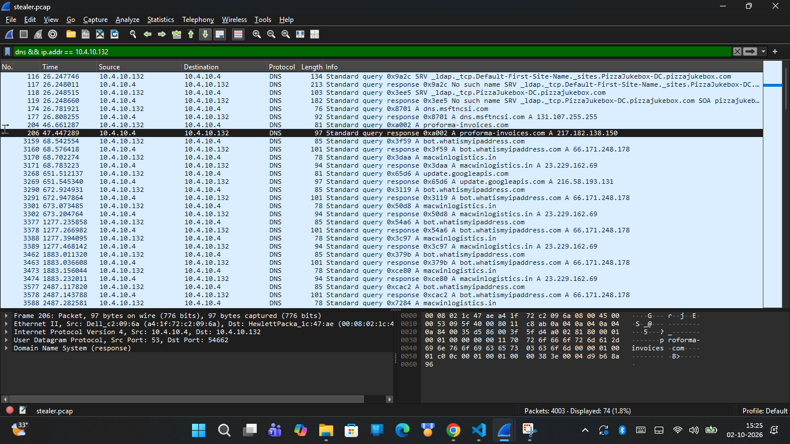
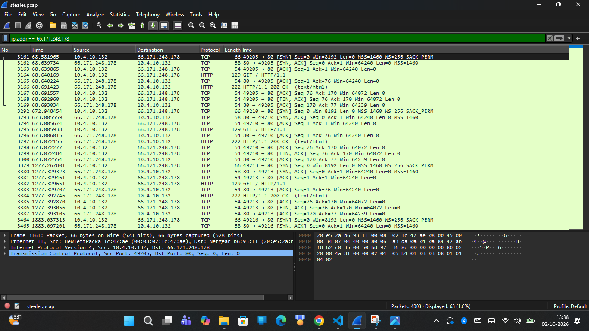
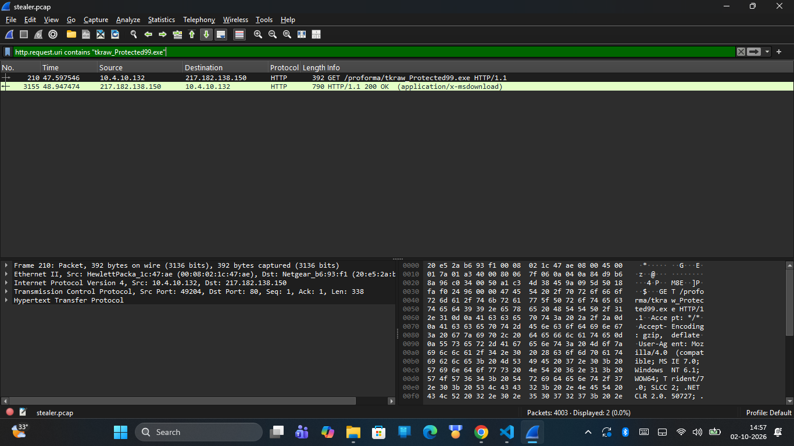
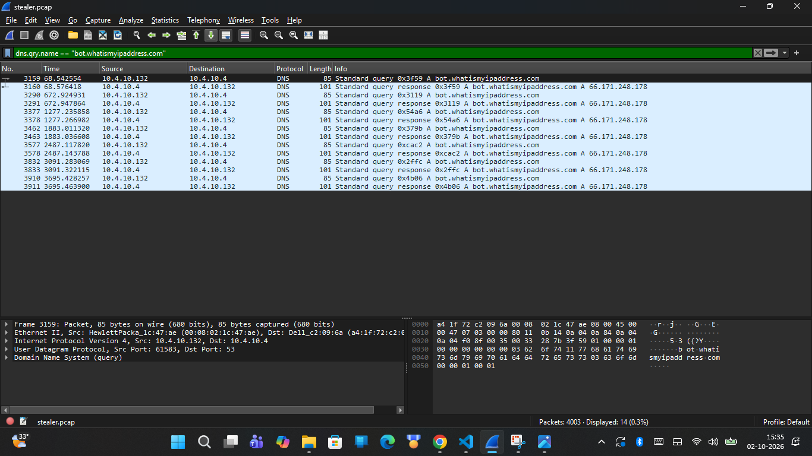
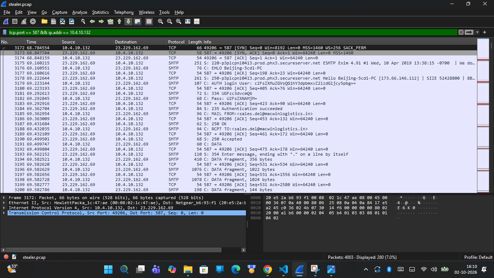
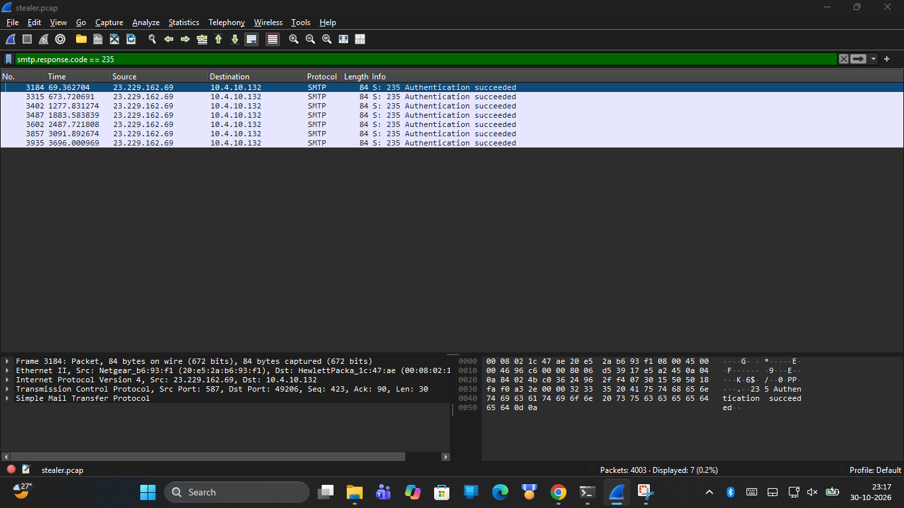
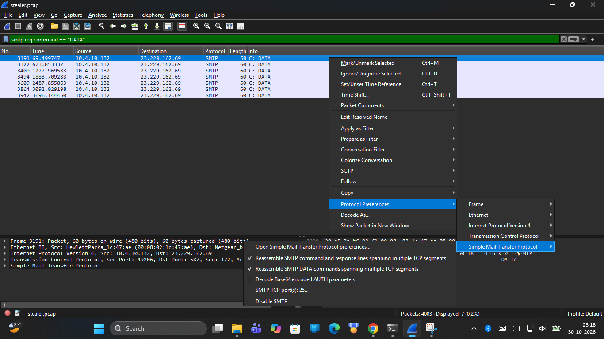
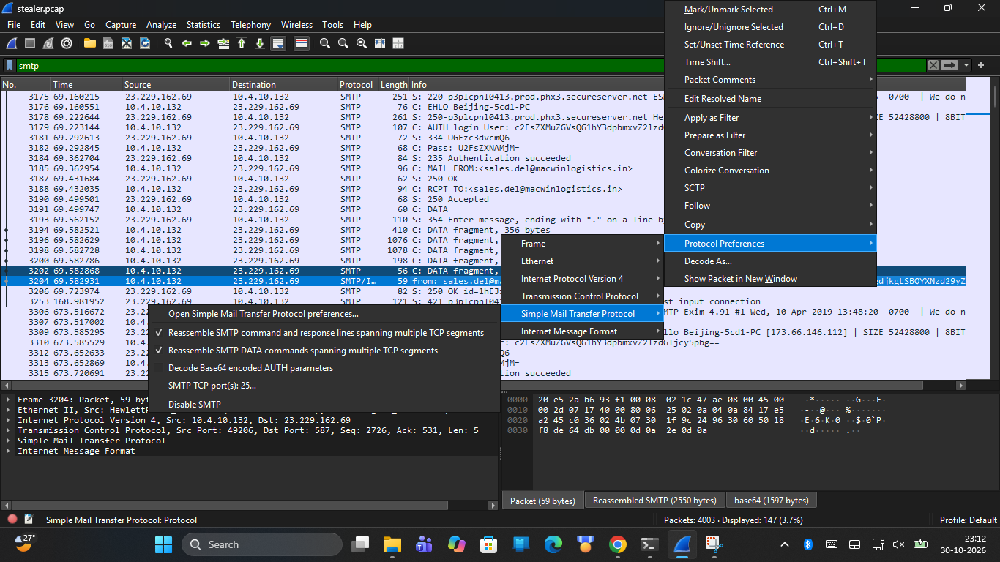
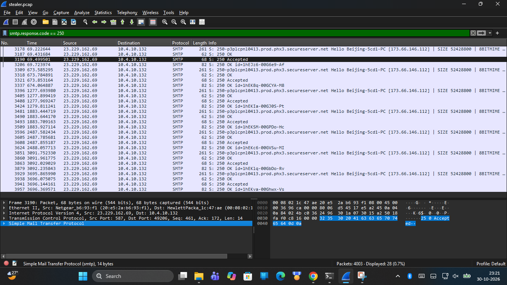
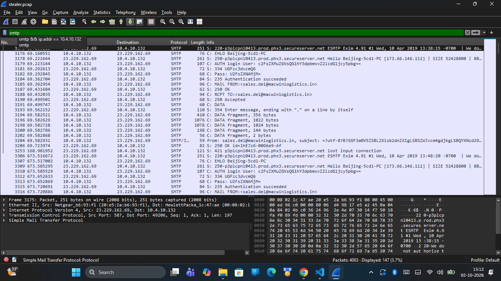

# CyberDefenders HawkEye Lab Report

## 1. Lab Overview

**Platform:** CyberDefenders
**Challenge:** HawkEye
**Category:** Network Forensics
**Primary Tool:** Wireshark

The HawkEye challenge involved reconstructing a keylogger data-exfiltration incident by analyzing network traffic, identifying indicators of compromise, extracting a suspicious executable, and documenting observed communication and exfiltration behavior.

---

## 2. Objective

The objective of this investigation was to analyze the supplied `stealer.pcap` capture and identify:

- The affected victim workstation and internal network topology.
- External network infrastructure involved in malware staging and command-and-control (C2).
- The malicious executable filename and cryptographic hashes.
- External IP reconnaissance mechanisms used by the malware.
- Email and SMTP infrastructure used for exfiltration.
- Stolen credential data and keylogger exfiltration telemetry.
- The recurring exfiltration interval and beaconing cadence.

---

## 3. Evidence

### Network Capture

**File:** `stealer.pcap`
**Packet count:** 4,003 packets
**File size:** 2,454,198 bytes
**MD5 Checksum:** `6DBD3019A87981CC77DD14C32D7AC3A4`
**SHA-256 Checksum:** `22106927C11836D29078DFBEC20BE9D6B61B1F3F47F95C758ACC47A1FB424E51`

### Extracted Executable

**File:** `tkraw_Protected99.exe`
**File size:** 2,025,472 bytes
**MD5 Checksum:** `71826BA081E303866CE2A2534491A2F7`
**SHA-256 Checksum:** `62099532750DAD1054B127689680C38590033FA0BDFA4FB40C7B4DCB2607FB11`

---

## 4. Investigation Methodology & Tooling

### 4.1 Tools Actually Used in This Investigation
- **Wireshark:** Primary interactive protocol analyzer used to inspect packet captures, filter by protocol (`dns`, `http`, `smtp`, `tcp`), follow TCP streams, inspect packet headers, and carve raw binary payloads.
- **PowerShell (`Get-FileHash`):** Used to compute cryptographic MD5 and SHA-256 hashes of disk evidence and verify integrity.
- **Python Standard Library:** Used for programmatic pcap timestamp parsing, packet frame indexing, and PNG file header verification.

### 4.2 Recommended Enterprise Tooling (Defensive Controls)
While the investigation was performed using offline packet forensics, enterprise environments require active network and endpoint detection:
- **Network Security Monitoring (Zeek):** Protocol-level logging of DNS requests (`dns.log`), HTTP downloads (`files.log`), and SMTP transactions (`smtp.log`) to generate structured alert records.
- **Intrusion Detection Systems (Suricata / Snort):** Signature-based alerting for known HawkEye keylogger User-Agents, plain-text SMTP authentication, and suspicious executable file transfers.
- **Endpoint Detection & Response (EDR / Sysmon):** Host-level monitoring of process creation (`Event ID 1`), outbound socket creation (`Event ID 3`), and binary execution from temporary user directories.
- **Egress Firewall Filtering:** Blocking outbound connections on ports 25, 465, and 587 from internal endpoints, restricting mail submission exclusively to designated corporate mail relays.

### 4.3 Investigation Workflow
1. Load `stealer.pcap` into Wireshark and examine global capture properties (total packets: 4,003; capture duration: 1:03:41).
2. Isolate internal host communications at the link (Ethernet) and network (IPv4) layers.
3. Trace DNS queries to identify staging infrastructure.
4. Follow HTTP streams to identify executable downloads and extract binary payloads for hashing.
5. Analyze post-infection network activity, including external IP lookups and SMTP authentication.
6. Track repeated exfiltration cycles to calculate interval timing.
7. Correlate findings with CyberDefenders lab questions and document indicators of compromise (IOCs).

---

## 5. Host Identification

Forensic analysis of the packet capture identified the primary host of interest:

- **Computer Name:** `Beijing-5cd1-PC` (identified via NetBIOS / SMB browser announcements).
- **Internal IPv4 Address:** `10.4.10.132`
- **MAC Address:** `0:08:02:1c:47:ae`
- **NIC Manufacturer:** Hewlett-Packard (OUI lookup: `00:08:02`, corporate headquarters in Palo Alto, California).
- **Operating System:** Windows NT 6.1 (Windows 7 / Windows Server 2008 R2, identified via HTTP User-Agent string).
- **Internal DNS Server:** `10.4.10.4`
- **Internal Network Scope:** 3 internal endpoints were observed in the capture (`10.4.10.132`, `10.4.10.10`, `10.4.10.11`).

---

## 6. Malicious File Download

At elapsed time ~47.6 seconds into the capture, the victim system initiated an HTTP connection to download the malicious payload.

### 6.1 DNS Resolution & Handshake
In **Frame 204**, `10.4.10.132` issued a DNS query for domain `proforma-invoices.com`. In **Frame 206**, the DNS server (`10.4.10.4`) returned an A record resolving the domain to **`217.182.138.150`** (hosted in France under OVH SAS).


*Figure 1: Wireshark packet capture showing standard DNS query (Frame 204) and response (Frame 206) resolving proforma-invoices.com to 217.182.138.150.*

In **Frames 207–209**, the host established a standard three-way TCP handshake (`SYN`, `SYN-ACK`, `ACK`) with `217.182.138.150` on port 80.


*Figure 2: Three-way TCP handshake establishing connection between internal victim 10.4.10.132 and external web server 217.182.138.150.*

### 6.2 Executable Request and Transfer
In **Frame 210**, the client sent an HTTP `GET /proforma/tkraw_Protected99.exe` request. In **Frame 212**, the server responded with `HTTP/1.1 200 OK` (identifying the web server software as **LiteSpeed**). The file payload transferred across reassembled TCP segments (Frames 213–3155), delivering a 2,025,472-byte Windows PE executable.


*Figure 3: HTTP transaction showing GET request for /proforma/tkraw_Protected99.exe and LiteSpeed 200 OK response.*

---

## 7. Malware Identification

The extracted executable (`tkraw_Protected99.exe`) was preserved as evidence. Hash calculations confirmed:
- **MD5:** `71826BA081E303866CE2A2534491A2F7`
- **SHA-256:** `62099532750DAD1054B127689680C38590033FA0BDFA4FB40C7B4DCB2607FB11`

Threat intelligence and forensic artifacts embedded in the subsequent SMTP exfiltration email headers identify the malware variant as:

**HawkEye Keylogger - Reborn v9**

---

## 8. SMTP-Based Exfiltration

Approximately 20 seconds after downloading the executable, the victim host initiated automated network reconnaissance followed by outbound data exfiltration.

### 8.1 External IP Reconnaissance
In **Frame 3159**, the host performed a DNS lookup for `bot.whatismyipaddress.com`. The query resolved to **`66.171.248.178`** in **Frame 3160**.

In **Frame 3164**, the host issued an HTTP request `GET /` to `bot.whatismyipaddress.com` (`66.171.248.178:80`). In **Frame 3167**, the server returned an `HTTP/1.1 200 OK` response with a 14-byte payload containing the victim workstation's actual external public IP: **`173.66.146.112`**.

> [!IMPORTANT]
> **Forensic IP Distinction:**
> - **`66.171.248.178`** is the DNS A record of the external service `bot.whatismyipaddress.com`.
> - **`173.66.146.112`** is the victim's external public IP address returned in the HTTP response payload, later corroborated in the SMTP server's greeting banner.


*Figure 4: DNS query and HTTP transaction to bot.whatismyipaddress.com returning the victim's public IP (173.66.146.112).*

### 8.2 SMTP Mail Server Connection
In **Frames 3168–3170**, `10.4.10.132` initiated a TCP connection to mail server **`23.229.162.69`** on port **`587`** (submission port, located in the United States under GoDaddy/Secureserver.net). In **Frame 3173**, the mail server transmitted its service banner:

```
220-p3plcpnl0413.prod.phx3.secureserver.net ESMTP Exim 4.91 #1 Wed, 10 Apr 2019 13:38:15 -0700
220-We do not authorize the use of this system to transport unsolicited,
220 and/or bulk e-mail.
```

In **Frame 3174**, the client sent `EHLO Beijing-5cd1-PC`. The server responded acknowledging the client's public IP: `250 Hello Beijing-5cd1-PC [173.66.146.112]`.


*Figure 5: TCP connection and initial SMTP 220 banner from Exim 4.91 server on port 587.*

### 8.3 Authentication & Credential Abuse
In **Frame 3180**, the malware initiated authentication using `AUTH LOGIN`. The captured stream contained base64-encoded credentials:
- Username (Frame 3180): `[REDACTED_BASE64_USER]` $\rightarrow$ **`sales.del@macwinlogistics.in`**
- Password (Frame 3182): `[REDACTED_BASE64_PASSWORD]` $\rightarrow$ **`[REDACTED_LAB_PASSWORD]`**

In **Frame 3184**, the mail server confirmed successful authentication: `235 Authentication succeeded`.


*Figure 6: SMTP AUTH LOGIN exchange showing base64 credentials and 235 Authentication succeeded response.*

### 8.4 Stolen Data Transmission
In **Frames 3185 and 3188**, the client specified `MAIL FROM:<sales.del@macwinlogistics.in>` and `RCPT TO:<sales.del@macwinlogistics.in>`, followed by the `DATA` command in **Frame 3191**.


*Figure 7: SMTP envelope commands (MAIL FROM, RCPT TO) and DATA command for keylogger payload delivery.*

In **Frame 3194**, the keylogger transmitted the exfiltration email body. The message header included:
- **Subject:** `HawkEye Keylogger - Reborn v9 - [Beijing-5cd1-PC/10.4.10.132]`
- **Body Content:** System hardware inventory, operating system details, external IP `173.66.146.112`, captured keystrokes, and harvested web credentials, including Bank of America login credentials: `oman.mcguire:[REDACTED_LAB_PASSWORD]`.


*Figure 8: Decoded SMTP email payload revealing HawkEye Keylogger subject line, keystrokes, and stolen credentials.*

In **Frame 3206**, the server acknowledged delivery with status: `250 OK id=... Message accepted for delivery`.


*Figure 9: Final SMTP 250 response confirming the exfiltrated email was accepted for delivery by the remote mail server.*

---

## 9. Exfiltration Pattern

The packet capture documents seven successive exfiltration cycles over the 63-minute duration. Each cycle repeats the identical operational sequence: an external IP query via `bot.whatismyipaddress.com` followed by authenticated SMTP transmission on port 587.

| Cycle # | Capture Elapsed Time | Packet Frame Range | Protocol Sequence | Cycle Interval |
|:---:|:---:|:---:|:---|:---:|
| **1** | ~68.5 s | Frames 3159–3208 | DNS $\rightarrow$ HTTP $\rightarrow$ SMTP | Baseline |
| **2** | ~672.9 s | Frames 3290–3339 | DNS $\rightarrow$ HTTP $\rightarrow$ SMTP | 604.4 s (~10 min) |
| **3** | ~1277.2 s | Frames 3377–3426 | DNS $\rightarrow$ HTTP $\rightarrow$ SMTP | 604.3 s (~10 min) |
| **4** | ~1883.0 s | Frames 3462–3511 | DNS $\rightarrow$ HTTP $\rightarrow$ SMTP | 605.8 s (~10 min) |
| **5** | ~2487.1 s | Frames 3577–3626 | DNS $\rightarrow$ HTTP $\rightarrow$ SMTP | 604.1 s (~10 min) |
| **6** | ~3091.3 s | Frames 3832–3881 | DNS $\rightarrow$ HTTP $\rightarrow$ SMTP | 604.2 s (~10 min) |
| **7** | ~3695.4 s | Frames 3910–3959 | DNS $\rightarrow$ HTTP $\rightarrow$ SMTP | 604.1 s (~10 min) |

The measured interval between exfiltration cycles consistently measures **604–606 seconds**, establishing an automated beaconing interval of **10 minutes**.


*Figure 10: Wireshark conversation overview and packet timeline demonstrating recurring 10-minute SMTP exfiltration cycles.*

---

## 10. Indicators of Compromise

| Type | Indicator | Context |
|---|---|---|
| Internal Host | `10.4.10.132` | Compromised victim system (`Beijing-5cd1-PC`) |
| DNS Server | `10.4.10.4` | Internal organization DNS server |
| External IP | `217.182.138.150` | Web server hosting malware (`proforma-invoices.com`) |
| External IP | `66.171.248.178` | External IP lookup web server (`bot.whatismyipaddress.com`) |
| Public IP (Victim) | `173.66.146.112` | Public IP of victim system (returned in HTTP payload) |
| SMTP Server | `23.229.162.69` | Destination mail relay for exfiltration (port 587) |
| Staging Domain | `proforma-invoices.com` | Domain delivering `tkraw_Protected99.exe` |
| Recon Domain | `bot.whatismyipaddress.com` | Service queried for public IP discovery |
| Mail Domain | `macwinlogistics.in` | Queried apex domain for destination mail server (earlier notes cited `mail.winlogistics.in`) |
| Malicious File | `tkraw_Protected99.exe` | HawkEye Keylogger executable (2,025,472 bytes) |
| MD5 | `71826BA081E303866CE2A2534491A2F7` | Executable MD5 checksum |
| SHA-256 | `62099532750DAD1054B127689680C38590033FA0BDFA4FB40C7B4DCB2607FB11` | Executable SHA-256 checksum |

---

## 11. Key Findings

1. **Intrusion Reconstruction:** The capture contains 4,003 packets documenting the download of `tkraw_Protected99.exe` via HTTP from `proforma-invoices.com` (`217.182.138.150`).
2. **Victim Identification:** The primary infected workstation is `Beijing-5cd1-PC` (`10.4.10.132`, MAC `0:08:02:1c:47:ae`, HP NIC).
3. **Payload Extraction:** The executable was successfully carved from the HTTP stream and verified cryptographically.
4. **Malware Variant:** Telemetry and subject headers conclusively identify the malware as **HawkEye Keylogger - Reborn v9**.
5. **Reconnaissance & Egress:** The malware queries `bot.whatismyipaddress.com` to discover its public IP (`173.66.146.112`) before every exfiltration event.
6. **Data Exfiltration:** Exfiltration occurs over plain-text authenticated SMTP (`sales.del@macwinlogistics.in`) to `23.229.162.69:587`.
7. **Beacon Interval:** Exfiltration recurs with strict regularity every **10 minutes** (604–606 seconds).

---

## 12. Investigation Limitations

- **Network-Level Visibility:** The provided evidence consists solely of network packet captures (`stealer.pcap`). The pcap does not contain host endpoint telemetry, such as process command-lines, registry modification keys, or initial email phishing vectors.
- **Credential Sensitivity:** Lab-specific credentials recovered during the investigation are documented solely to fulfill CyberDefenders forensic challenge requirements and are excluded from production IOC distributions.

---

## 13. Supporting Documentation

Additional documentation is available in this directory:
- `questions-and-answers.md` — All 24 CyberDefenders questions and answers.
- `investigation-notes.md` — Detailed technical notes and stream observations.
- `iocs.md` — Consolidated indicators of compromise.
- `timeline.md` — High-resolution packet frame timeline.
- `evidence-integrity.md` — Cryptographic hash verification table.
- `screenshots/` — All 10 verified Wireshark evidence screenshots.

---

## 14. Conclusion

The CyberDefenders HawkEye investigation demonstrated an end-to-end network forensics workflow for reconstructing an advanced keylogger intrusion. By analyzing packet timestamps, reassembling application-layer streams, and tracking periodic beaconing patterns, the full lifecycle—from binary delivery to automated SMTP data exfiltration—was documented with empirical evidentiary backing.
